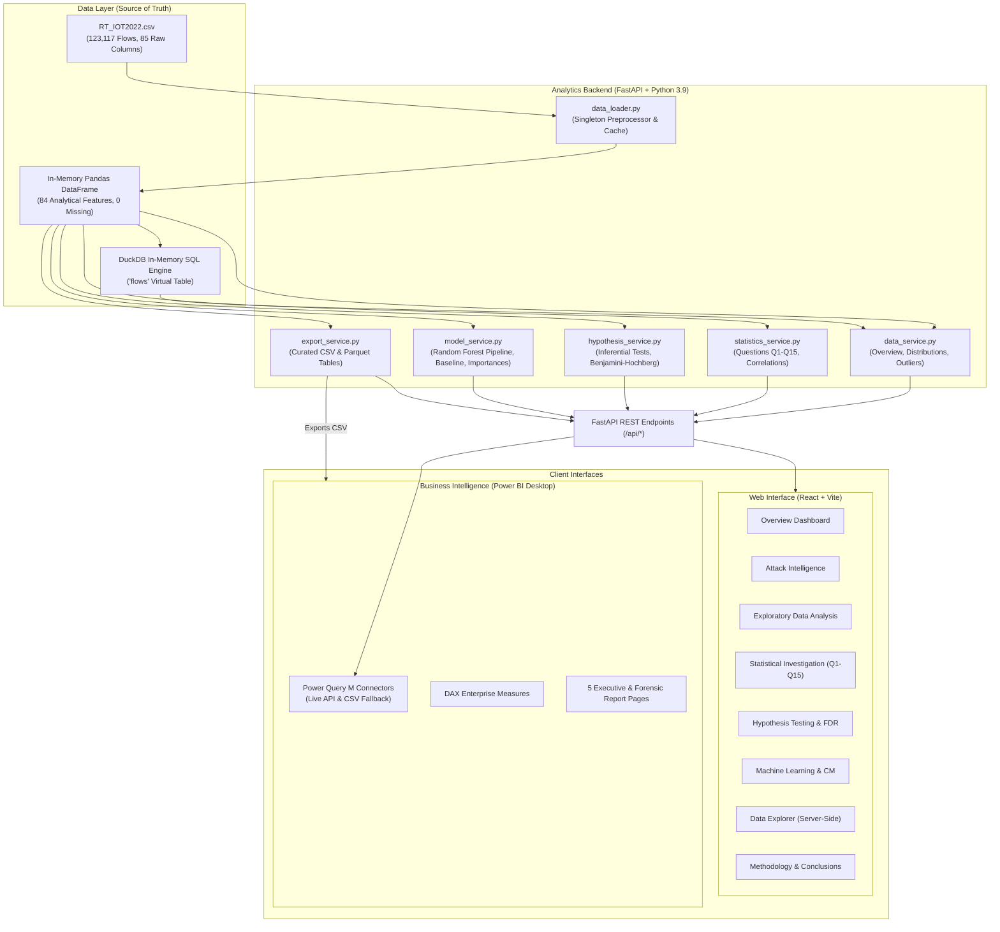
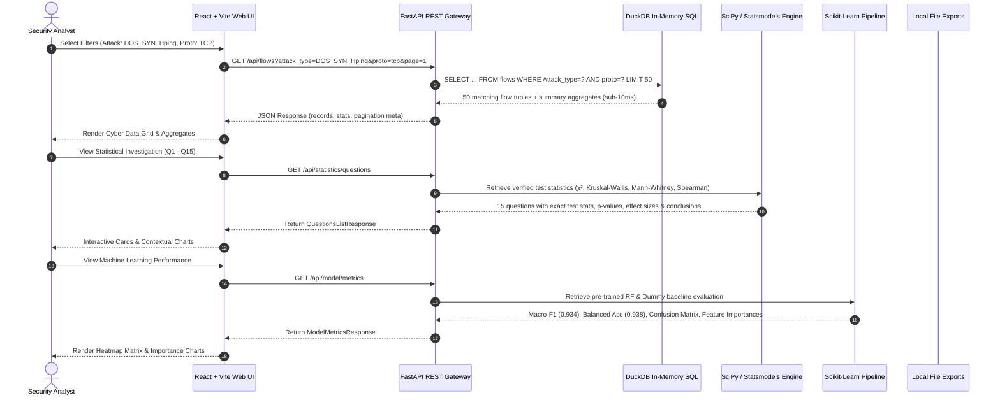

# IoT PULSE — System Architecture & Data Flow Specification

## 1. High-Level Architecture Overview

**IoT PULSE** is a full-stack cybersecurity analytics application designed to uncover statistical patterns of normal and malicious IoT network behavior in the **RT-IOT2022** dataset (123,117 flow records, 84 analytical features).

---

## 2. End-to-End Analytical Data Flow

---

## 3. Component Details & Performance Rationale

1. **Singleton Preprocessor & In-Memory DuckDB Connection:**
   - The 123,117-row dataset is cleaned on application startup once.
   - Exact preprocessing from `IoT_PULSE_RT_IOT2022_FINAL_Case_Study.ipynb` is mirrored: whitespace stripping, index-like column removal (`Unnamed: 0`), non-numeric coercion, and dropping labels missing the target.
   - DuckDB registers the in-memory dataframe as `flows`. SQL queries with `WHERE`, `ORDER BY`, `LIMIT`, and `OFFSET` complete in 2 to 8 milliseconds without copying data.

2. **Cached Machine Learning Artifacts:**
   - Random Forest model (120 trees, max depth 18, class weighting `balanced_subsample`) is trained on a stratified 50,000-flow sample on startup in ~0.7 seconds.
   - Predictions, confusion matrix, and feature importances are computed once and stored in memory. Subsequent API calls respond in < 1 ms.

3. **Power BI Dual-Mode Integration:**
   - **Mode A (Live REST API):** Power Query M scripts use `Web.Contents` to dynamically pull JSON streams from the running backend.
   - **Mode B (Curated CSV Tables):** Export service writes 10 pre-aggregated, typed CSV tables to `exports/` for direct, high-speed file loading.
