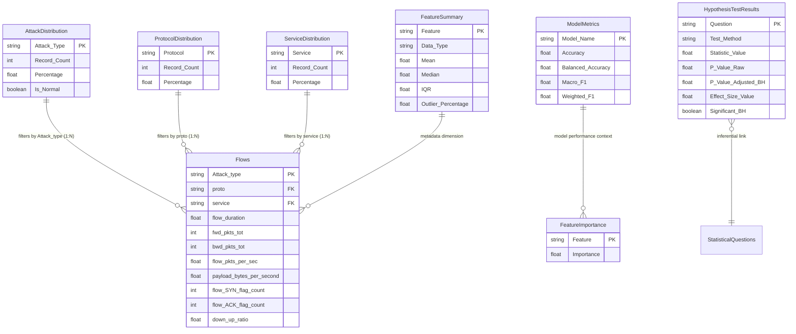

# IoT PULSE — Power BI Data Model & Schema Architecture

## 1. Relational Star Schema Architecture

The analytical data model uses a Star / Snowflake architecture optimized for interactive filtering, high-speed aggregations, and slice-and-dice across attack categories and network protocols.

---

## 2. Table Cardinalities & Cross-Filtering Behavior

| From Table (Dimension) | To Table (Fact) | Join Key | Cardinality | Cross Filter Direction | Security / Filter Behavior |
| :--- | :--- | :--- | :--- | :--- | :--- |
| `AttackDistribution` | `Flows` | `Attack_Type` = `Attack_type` | 1 to Many (1:*) | Single (Dimension to Fact) | Selecting an attack filters all flow aggregations |
| `ProtocolDistribution` | `Flows` | `Protocol` = `proto` | 1 to Many (1:*) | Single (Dimension to Fact) | Filtering by protocol isolates TCP / UDP / ICMP |
| `ServiceDistribution` | `Flows` | `Service` = `service` | 1 to Many (1:*) | Single (Dimension to Fact) | Filters by application service (MQTT, HTTP, DNS) |
| `FeatureImportance` | Independent Fact | `Feature` | N/A | None | Displays top predictive drivers |
| `HypothesisTestResults`| Independent Fact | `Question` | N/A | None | Provides formal inferential evidence |
| `ModelMetrics` | Independent Fact | `Model_Name` | N/A | None | Evaluates Random Forest vs baseline |
